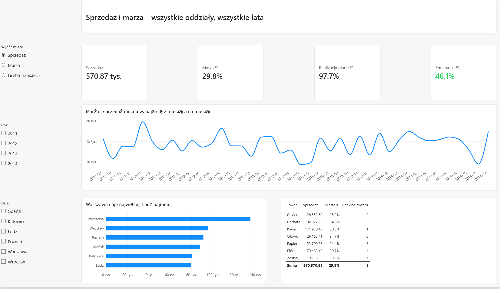
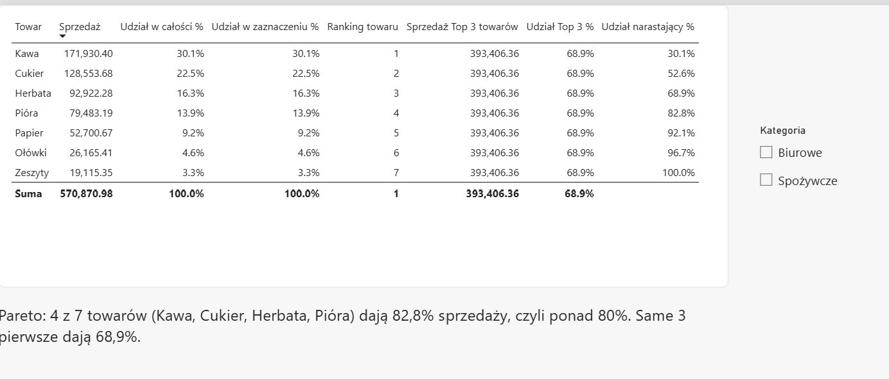
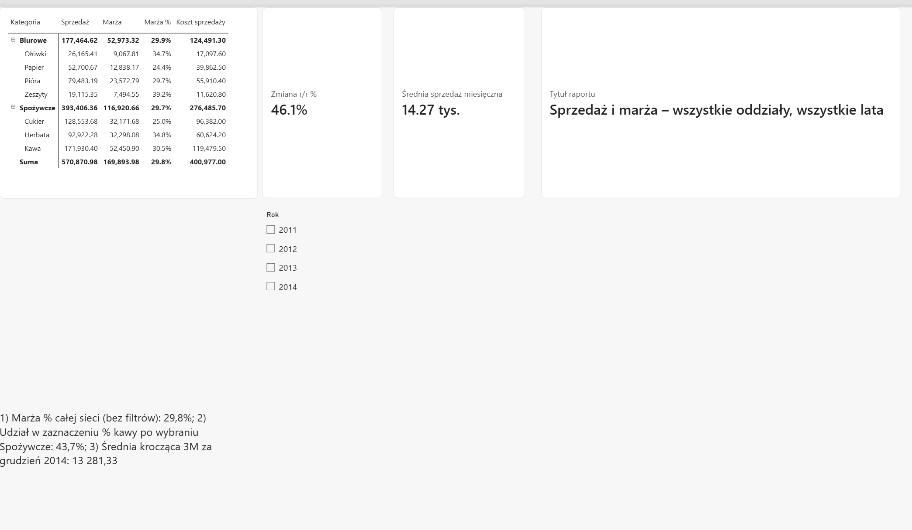
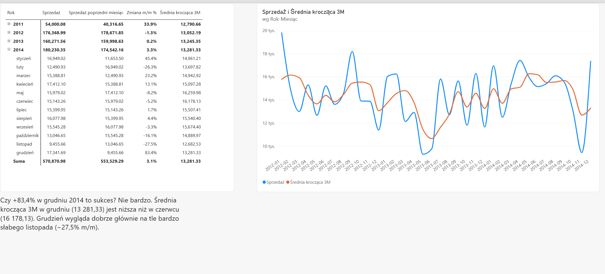
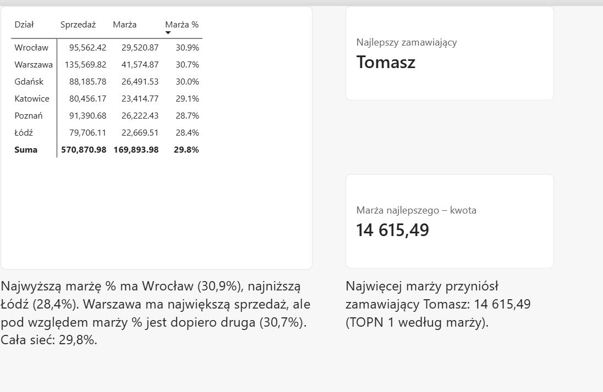

# Wholesale Margin & Advanced DAX – Power BI Manager Dashboard

A Power BI case study that goes beyond simple sums: it calculates **gross margin per transaction with iterators**, explores **row vs. filter context**, builds **shares, rankings, Top N and Pareto analysis**, adds **month-over-month change and a 3-month moving average**, and combines everything into a **one-page dashboard for a sales network manager**.

> **Note:** This is a course project from the *Business Data Analysis* (Biznesowa Analiza Danych) Power BI course. The dataset is a training dataset of a fictional wholesale company with six branches in Poland (2011–2014). The model builds on my previous project, **wholesale-sales-star-schema-dax** (see my repositories).

---

## Business questions

1. What is the real **gross margin** of the network, of each product and of each branch?
2. Which products drive sales: what is each product's **share**, **rank**, and do the **Top 3** products dominate?
3. How many products generate **80% of sales** (Pareto)?
4. Is a strong month a real improvement, or only a rebound after a weak month? (**m/m change vs. moving average**)
5. Which customer (orderer) brings the **highest margin**?
6. What should a manager see on **one page** to monitor the network?

---

## Data

| Table | Type | Content |
|---|---|---|
| Sprzedaż (Sales) | fact | transactions: date, branch, product, quantity, price, amount, orderer |
| Plan | fact | monthly sales plan per branch |
| Towary (Products) | dimension | 7 products in 2 categories + **purchase cost** merged from the price list |
| Oddzialy (Branches) | dimension | 6 branches, region, manager, headcount, population |
| Kalendarz (Calendar) | dimension | DAX date table, marked as date table |
| Cennik_zakupu.xlsx | source | purchase cost per product (merged into Products, load disabled) |

---

## What I built

### Power Query
- Imported the purchase price list from Excel and **merged** it into the Products dimension (left outer join, 7 of 7 rows matched).
- Expanded only the needed column (*Koszt zakupu* – purchase cost) and **disabled loading** of the helper query.

### DAX – iterators and context

```DAX
Marża =
SUMX(
    'Sprzedaż',
    'Sprzedaż'[Ilość] * ('Sprzedaż'[Cena] - RELATED(Towary[Koszt zakupu]))
)

Koszt sprzedaży = [Sprzedaż] - [Marża]
Marża % = DIVIDE([Marża], [Sprzedaż])
```

- Showed why `SUM(Amount) - SUM(Cost)` is **wrong** (it subtracts the sum of 7 list prices, not the cost of the units sold).
- Demonstrated **context transition**: a calculated column `= SUM(...)` returns the network total in every row, while `= [Sales]` returns the branch's own sales.

### DAX – variables, averages and a dynamic title

```DAX
Zmiana r/r % =
VAR biezaca = [Sprzedaż]
VAR poprzednia = [Sprzedaż RP]
RETURN DIVIDE(biezaca - poprzednia, poprzednia)

Średnia sprzedaż miesięczna = AVERAGEX(VALUES(Kalendarz[Rok-Miesiąc]), [Sprzedaż])

Tytuł raportu =
VAR oddzial = SELECTEDVALUE(Oddzialy[Dział], "wszystkie oddziały")
VAR rok = SELECTEDVALUE(Kalendarz[Rok], "wszystkie lata")
RETURN "Sprzedaż i marża – " & oddzial & ", " & rok
```

### DAX – shares, ranking, Top N, Pareto

```DAX
Udział w całości % = DIVIDE([Sprzedaż], CALCULATE([Sprzedaż], ALL(Towary)))
Udział w zaznaczeniu % = DIVIDE([Sprzedaż], CALCULATE([Sprzedaż], ALLSELECTED(Towary)))
Ranking towaru = RANKX(ALL(Towary[Towar]), [Sprzedaż])
Sprzedaż Top 3 towarów = CALCULATE([Sprzedaż], TOPN(3, ALL(Towary[Towar]), [Sprzedaż]))

Udział narastający % =
VAR sprzedazTowaru = [Sprzedaż]
VAR narastajaco =
    SUMX(
        FILTER(ALL(Towary[Towar]), [Sprzedaż] >= sprzedazTowaru),
        [Sprzedaż]
    )
RETURN DIVIDE(narastajaco, CALCULATE([Sprzedaż], ALL(Towary)))
```

### DAX – time intelligence

```DAX
Sprzedaż poprzedni miesiąc = CALCULATE([Sprzedaż], DATEADD(Kalendarz[Data], -1, MONTH))

Zmiana m/m % =
VAR biezaca = [Sprzedaż]
VAR poprzednia = [Sprzedaż poprzedni miesiąc]
RETURN DIVIDE(biezaca - poprzednia, poprzednia)

Średnia krocząca 3M =
VAR okres = DATESINPERIOD(Kalendarz[Data], MAX(Kalendarz[Data]), -3, MONTH)
RETURN DIVIDE(CALCULATE([Sprzedaż], okres), 3)
```

### DAX – best customer by margin

```DAX
Najlepszy zamawiający =
VAR najlepszy = TOPN(1, ALL('Sprzedaż'[Zamawiający]), [Marża])
RETURN CONCATENATEX(najlepszy, 'Sprzedaż'[Zamawiający], ", ")

Marża najlepszego zamawiającego =
MAXX(TOPN(1, ALL('Sprzedaż'[Zamawiający]), [Marża]), [Marża])
```

> Lesson learned: `top` is a reserved word in DAX and cannot be used as a variable name.

### Report pages

| Page | Content |
|---|---|
| **Marża** | matrix Category → Product with Sales, Margin, Margin %; KPI cards; year slicer |
| **Towary** | category slicer, product table with share of total vs. share of selection, rank, Top 3, **Pareto** + conclusion |
| **Trend** | Year → Month matrix with m/m change; line chart of sales vs. 3-month moving average (from 2012) |
| **Panel kierownika** | manager dashboard: dynamic title, 4 KPI cards, **field parameter** to switch Sales / Margin / Transactions, trend line, branch bar chart, product table |
| **Oddziały** | margin % by branch, best customer by margin (TOPN 1) + conclusions |

#### Manager dashboard



#### Products – shares, ranking, Pareto



#### Margin, trend and branches





Dashboard design rules applied: overview → detail (KPIs on top, trend in the middle, table at the bottom), **titles state the conclusion** instead of describing the chart, one main colour plus one accent, red/green only for deviations (conditional formatting on the y/y card), shared alignment grid, max 6–7 visuals per page.

---

## Key findings

| Metric | Value |
|---|---|
| Network sales 2011–2014 | 570 870,98 |
| Gross margin | 169 893,98 (**29,8%**) |
| Highest / lowest margin % product | Zeszyty 39,2% / Papier 24,4% |
| Top 3 products (Kawa, Cukier, Herbata) | **68,9%** of sales – exactly the *Food* category |
| Pareto | **4 of 7 products** generate 82,8% of sales |
| Highest / lowest margin % branch | **Wrocław 30,9%** / Łódź 28,4% – Warszawa has the largest sales but is 2nd in margin % |
| Best customer by margin | **Tomasz – 14 615,49** |
| December 2014 | +83,4% m/m, but the 3-month moving average (13 281,33) is **lower than in June** – December looks good mainly against a weak November |

**Pitfalls documented:**
- A y/y change without a year filter (+46,1%) compares 2011–2014 with 2011–2013, so it should always be shown with a year or month selected.
- Share of total (ALL) and share of selection (ALLSELECTED) give the same 30,1% for coffee until a category is selected (then 43,7%).

---

## Skills demonstrated

`Power BI Desktop` · `Power Query (merge, disable load)` · `star schema` · `DAX iterators (SUMX, AVERAGEX, MAXX, CONCATENATEX)` · `RELATED` · `row vs. filter context` · `context transition` · `VAR / RETURN` · `ALL vs. ALLSELECTED` · `RANKX` · `TOPN` · `Pareto analysis` · `time intelligence (DATEADD, DATESINPERIOD)` · `moving average` · `field parameters` · `dynamic titles (SELECTEDVALUE)` · `conditional formatting` · `dashboard design`

---

## Files

| File | Description |
|---|---|
| `Staniszewska_Kalina_Zaj04.pbix` | Power BI report |
| `screenshots/` | report pages |

## How to open

Download the `.pbix` file and open it in **Power BI Desktop** (free, Windows). The data is embedded in the file.

---

*Author: Kalina Staniszewska*
